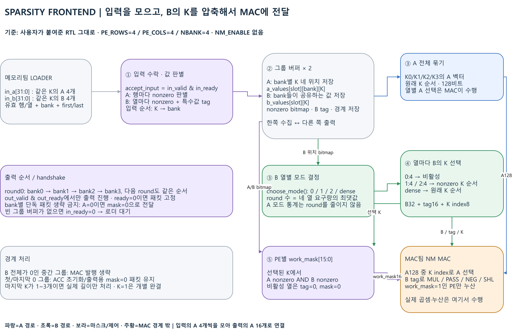

# SET5용 N:4 스파시티 — A 16개 전체 전달 버전

> **GitHub 웹 업로드용: 총 82개 파일입니다.** 개별 검증 로그 56개는 [verification_logs.zip](results/verification_logs.zip)에 그대로 묶었습니다. 로그를 보려면 이 ZIP을 `results/` 안에 풀면 됩니다. RTL·테스트·구조도·측정 CSV는 전체본과 같습니다.


**A는 nonzero만 판별하고 원래 K 순서로 16개를 묶어 보냅니다. B는 nonzero와 특수값을 판별하고, 열마다 필요한 K를 골라 압축합니다. MAC은 8비트 K 선택 신호로 A를 직접 고릅니다.**

기본 설정은 **SET5 1안, ACC 4세트, 4×4 PE, INT8 입력/INT32 누산**입니다. SET5 2·3안도 `gemm_top.SET5_PLAN`만 바꿔 선택합니다. 세 안의 로더·메모리 요청 순서·reuse 정책은 메모리팀 원본을 유지합니다. 이 묶음은 요청한 ACC 4세트 구성용이며 ACC 2세트 변형은 포함하지 않습니다.

**검증 완료:** 세 안 모두 최대 크기 64×128×1024까지 정답 일치. 팀원 원본 파일을 적용한 RTL로 **총 423회 측정 실행(업로드 직전 추가 6회 포함)**과 **65,728개 스파시티 그룹 검사**를 통과했습니다. 기본 1안의 HTML 20×12×8 입력은 원본 920→880사이클, MAC 전달 120→60패킷입니다. 작은 입력에서 사이클이 늘어난 경우도 포함해 [실측 결과](results/RESULTS.md)에 정리했습니다.

이번 수정은 **팀원 파일 그대로 적용 + top의 사용하지 않는 파라미터 연결 제거**입니다. `reference/teammate_sparsity_frontend.v`와 실제 RTL의 바이트 일치를 `verify_sources.py`가 검사합니다. 로더·제어·결과 저장·MAC 파일이 이전 완성본과 같은지도 `reference/revision.json`의 SHA-256으로 검사합니다.

구조도는 이전에 만든 세 페이지를 수정한 것입니다. [편집용 diagrams.net 파일](diagrams/Sparsity_Frontend_Logic.drawio)을 열면 전체 흐름·RTL 상세·입출력 규약을 볼 수 있습니다.



[RTL 상세 구조](diagrams/Sparsity_Detail.png) · [입출력 규약과 예시](diagrams/Sparsity_Interface.png)

## 1. 어디를 담당하는 코드인가?

```text
메모리팀 SET5                 우리 스파시티                         MAC팀 NM
───────────────────         ───────────────────────────         ─────────────────────
gemm_control                K 4개 × ACC별 A 수집                  A[r, K선택[c]] 선택
     ↓                      A: nonzero 위치 기록                 B 특수값 연산 선택
operand_loader ───────────→ B: nonzero + 특수값 분류 ───────────→ work_mask=1인 PE 누산
  매번 같은 K의              열별 0:4 / 1:4 / 2:4 / dense           ↓
  A 4개 + B 4개              B 압축 발행                           result_writer
  + bank/first/last          A 전체 16개 + B 4개 + K위치 + 마스크
```

`gemm_top`은 이 경로의 배선과 SET5 읽기 안을 선택합니다. `gemm_control`, `operand_loader`, `result_writer`의 RTL 내용은 변경하지 않았습니다.

## 2. 입력은 아직 A 4개씩 들어온다

로더 입력 순서는 기존대로 **K → ACC bank**입니다. 예를 들어 K=0의 bank 0·1·2·3 패킷이 들어오고, 이어 K=1의 bank 0·1·2·3 패킷이 들어옵니다. 행렬 끝에서는 실제 존재하는 bank만 들어옵니다.

각 입력 패킷에는 같은 K의 `in_a[31:0]` 4개와 `in_b[31:0]` 4개, 유효 행/열, bank 번호, first/last가 있습니다. 스파시티가 K=0~3을 모으면 **bank 하나당 A 16개**가 준비됩니다. B는 bank들이 공유하므로 그룹당 B 16개만 저장합니다.

여기서 M=4는 **연속 K 네 위치를 묶는 N:M의 M**입니다. 행렬 A의 행 수 M, ACC 4세트, 로더의 packet slots 4개와는 다른 개념입니다.

## 3. A는 어떤 순서로 보내나?

**열별 K 선택에 맞추어 A를 재배열하지 않습니다.** 아래 순서로 네 개의 원래 A 벡터를 연결합니다. B의 압축 round가 바뀌어도 같은 bank/그룹의 A 128비트는 같습니다.

| A 버스 | 담긴 값 |
|---|---|
| `[31:0]` | K=0의 A 행 0·1·2·3 |
| `[63:32]` | K=1의 A 행 0·1·2·3 |
| `[95:64]` | K=2의 A 행 0·1·2·3 |
| `[127:96]` | K=3의 A 행 0·1·2·3 |

정확한 위치는 `op_a[8*(4*k+r) +: 8] = A[r, group_k_base+k]`입니다. 마지막 그룹의 부족한 K와 유효하지 않은 행은 0으로 채웁니다. 값 자체를 바꾸거나 A에 특수값 태그를 붙이지 않습니다.

## 4. B의 네 가지 모드

각 B 열의 K 네 위치에서 nonzero 개수를 셉니다. 정해진 개수에 맞추어 값을 버리는 pruning은 하지 않습니다.

| 모드 코드 | B의 실제 nonzero 개수 | 한 열의 예: K0,K1,K2,K3 | 그 열이 사용하는 K |
|---|---:|---|---|
| `00` / 0:4 | 0 | `[0,0,0,0]` | 없음 |
| `01` / 1:4 | 1 | `[0,0,0,5]` | round 0: K3 |
| `10` / 2:4 | 2 | `[0,5,0,2]` | round 0: K1, round 1: K3 |
| `11` / dense | 3 또는 4 | `[7,0,3,1]` | K0 → K1 → K2 → K3 |

1:4와 2:4에서는 nonzero K를 작은 순서로 선택합니다. dense에서는 원래 K 순서로 돌아갑니다. **3개가 nonzero여도 현재 네 모드 규약에서는 4 round**입니다. 마지막 그룹이 3개 K라면 dense도 실제 길이인 3 round만 사용합니다.

네 열은 서로 다른 K를 선택할 수 있습니다. 한 그룹의 총 round 수는 네 열이 요구하는 round 수의 최댓값입니다.

| 열별 모드 | 그룹의 데이터 round 수 |
|---|---:|
| 0,0,0,0 | 0 |
| 1,0,1,0 | 1 |
| 2,1,0,2 | 2 |
| dense,1,2,0 | 4 |

먼저 끝난 열은 B=0, tag=ZERO, 그 열의 `work_mask`=0으로 보냅니다. A가 0인 PE도 마스크를 끄지만, **A 한 bank의 sparsity만으로 다른 bank와 발행 round 수를 다르게 만들지는 않습니다.** 공통 B 스케줄과 MAC의 ACC 순환 순서를 유지하기 위해서입니다.

전체 B가 0인 중간 그룹은 MAC 입력을 생략합니다. 첫 그룹은 ACC 초기화, 마지막 그룹은 결과 출력을 위해 **bank마다 마스크가 0인 제어 패킷 1개**를 보냅니다. 첫 그룹이 곧 마지막 그룹이면 1개로 두 역할을 합니다.

## 5. 실제로 어떤 곱을 하게 되나?

한 bank의 A와, 공유되는 B의 K 네 행을 다음처럼 가정합니다.

```text
A: 행별로 표시                    B: K별로 표시
          K0  K1  K2  K3                    열0 열1 열2 열3
행0        2   0   3   4          K0          0   1   7   0
행1       -1   5   0   2          K1          5   0   0  -1
행2        6   7   8   0          K2          0   0   0   8
행3        0   9  -2   1          K3          2   9   0   0
```

B 열별 모드는 `[2:4, 2:4, 1:4, 2:4]`입니다. 따라서 4개의 원래 K 패킷을 다음 2개 round로 줄입니다.

| round | B 열0·1·2·3 | 선택 K 열0·1·2·3 | 8비트 K 신호 |
|---|---|---|---|
| 0 | `[5,1,7,-1]` | `[1,0,0,1]` | `0x41` |
| 1 | `[2,9,0,8]` | `[3,3,0,2]` — 열2는 비활성 | `0x8F` |

예를 들어 **A의 행0**은 다음을 계산합니다.

| C 위치 | round 0 | round 1 | 합 |
|---|---|---|---:|
| C[0,0] | A[0,1]×5 = 0 → 마스크 0 | A[0,3]×2 = 4×2 | 8 |
| C[0,1] | A[0,0]×1 = 2 | A[0,3]×9 = 36 | 38 |
| C[0,2] | A[0,0]×7 = 14 | 비활성 → 마스크 0 | 14 |
| C[0,3] | A[0,1]×(−1) = 0 → 마스크 0 | A[0,2]×8 = 3<<3 | 24 |

**같은 round의 서로 다른 열이 서로 다른 K를 처리하는 것**이 기존 K 고정 패킷과의 차이입니다. 각 열의 C에 누산하므로 서로 다른 K의 항을 한 round에 계산해도 결과가 같습니다.

이 예의 전체 정답은 `[[8,38,14,24],[29,17,-7,-5],[35,6,42,57],[47,9,0,-25]]`입니다.

## 6. MAC에 실제로 연결하는 신호

| 스파시티 출력 → MAC 입력 | 폭 | 의미 |
|---|---:|---|
| `out_a` → `op_a` | 128 | 원래 K 순서의 A 16개 |
| `out_b` → `op_b` | 32 | 이번 round의 B, 열마다 1개 |
| `out_k_mask` → `column_k_position` | 8 | 각 B가 원래 어느 K였는지 |
| `out_b_tag` → `op_b_tag` | 16 | B 열마다 4비트 연산 태그 |
| `work_mask` → `work_mask` | 16 | PE별 실제 연산 허용 |
| `out_rows/out_cols` → `op_rows/op_cols` | 4+4 | 타일의 유효 행/열 |
| `out_first/out_last` → `op_first/op_last` | 1+1 | 초기화/결과 출력 경계 |
| `out_valid/out_ready` ↔ `op_valid/op_ready` | 1+1 | 패킷 수락 handshake |

`8bit_k_mask`는 **one-hot 마스크가 아니라 2비트 인덱스 네 개**입니다. `열0=[1:0]`, `열1=[3:2]`, `열2=[5:4]`, `열3=[7:6]`입니다. 값은 현재 그룹 안의 K offset 0~3입니다. 전역 K는 디버그 신호 `out_k + offset`입니다.

이름이 비슷한 마스크들의 용도는 다음처럼 구분합니다.

| 신호 | 비트 배치 | 용도 |
|---|---|---|
| `in_rows/in_cols`, `out_rows/out_cols` | 각 4비트, 행/열 하나당 1비트 | 행렬 끝의 유효 위치 |
| `out_group_mask_a` | `[4*r +: 4]`, bit k는 A[r,k] nonzero | A 그룹의 원래 위치 기록 |
| `out_group_mask_b` | `[4*c +: 4]`, bit k는 B[k,c] nonzero | B 열의 원래 위치 기록 |
| `out_k_mask` | `[2*c +: 2]`는 이번 B의 K 인덱스 | MAC의 A 선택 |
| `work_mask` | bit `[4*r+c]`는 PE[r,c] | 이번 round의 실제 누산 허용 |

실제 PE 마스크는 `work_mask[4*r+c] = 유효 행/열 AND A[r,선택K]≠0 AND B[선택K,c]≠0`입니다. 비활성 열의 K 신호가 0이어도 K0를 연산하라는 뜻이 아닙니다. 태그와 PE 마스크가 연산을 막습니다.

B 태그는 MAC팀 코드와 동일합니다.

| B 값 | tag | MAC 연산 |
|---|---|---|
| 0 | `0` | 0 |
| +1 | `2` | +A |
| −1 | `3` | −A |
| +2,+4,+8,+16,+32,+64 | `9,A,B,C,D,E` | A<<1 … A<<6 |
| 나머지 INT8 | `1` | 일반 signed 곱셈 |

음의 2의 거듭제곱과 −128은 일반 곱셈입니다. shift 전에 A를 16비트로 부호 확장하는 동작은 MAC팀 product RTL에 있습니다.

`out_group_mask_a/b`, `out_group_mode_a/b`, `out_group_len`, `out_k`, `out_bank`는 그룹 상태와 검증을 위한 신호입니다. **그룹 모드 버스를 MAC에 추가로 요구하지 않습니다.** A의 mode 통계는 nonzero 개수를 보여주는 진단 정보이며 A를 압축하거나 재배열하는 지시가 아닙니다.

## 7. ACC와 handshake에서 지키는 순서

출력은 **round → bank** 순서입니다. 예를 들어 2 round, bank 네 개면 `r0/b0,b1,b2,b3 → r1/b0,b1,b2,b3`입니다. MAC팀은 별도의 bank 입력 없이 이 순서와 first/last로 ACC를 순환시킵니다. 모든 유효 bank에 같은 round 수를 발행합니다.

**MAC 연결 규칙:** 열마다 서로 다른 K를 고르는 것은 허용하지만, bank별로 패킷을 따로 생략하면 안 됩니다. A가 전부 0인 bank도 마스크 0인 패킷을 같은 순서로 보냅니다. 중간 B all-zero 그룹은 모든 bank를 함께 생략합니다. `out_bank`는 현재 MAC의 bank 선택 포트에 연결되지 않으며, MAC은 수락 순서와 first/last로 ACC를 선택합니다.

K가 한 그룹 안에서 끝나고 발행 round가 하나뿐이면 `first=last=1`인 각 타일이 물리 ACC0을 재사용할 수 있습니다. 각 결과는 출력 레지스터로 넘긴 뒤 다음 타일을 시작하므로, 논리 bank 번호와 물리 ACC 번호가 항상 같아야 하는 경우와 구분합니다.

K=1은 각 입력 패킷 자체가 타일의 처음이자 마지막이므로 별도로 완결합니다. K가 4의 배수가 아닌 경우에도 마지막 유효 K까지 모은 뒤 발행합니다. 유효 bank가 1·2·3개인 행렬 끝 블록도 처리합니다.

그룹 버퍼 두 개로 다음 입력 수집과 현재 그룹 출력을 겹칩니다. MAC이 `ready=0`이면 A/B/K/tag/마스크/경계 정보를 모두 고정하고, 빈 버퍼가 없으면 로더에 backpressure를 줍니다.

```text
입력 A32/B32 + bank/first/last
                 │
        A nonzero / B nonzero·tag
                 │
        ┌────────┴─────────────────────┐
        │ 그룹 버퍼 0 / 그룹 버퍼 1     │  한쪽 수집, 다른 쪽 발행
        │ A[bank][K] : bank별 A 16개    │
        │ B[K]       : 공유 B 16개      │
        │ A/B 위치 bitmap, 경계, 길이   │
        └────────┬─────────────────────┘
                 │ 완성된 그룹
        B 열별 모드 → 공통 round 수
                 │
        이번 round의 열별 K 선택
          ┌──────┼────────────────┐
          │      │                │
       A128    B32/tag16/K8     work_mask16
       원순서   선택한 B         A/B nonzero 교집합
          └──────┴───────┬────────┘
                        MAC
```

## 8. SET5의 세 안은 그대로 선택한다

| `SET5_PLAN` | 외부 읽기 방식 | 이번 처리에서의 의미 |
|---:|---|---|
| **1 — 기본** | 같은 K의 B 4개 → ACC 네 세트의 A | 기존 SET4 패킷 흐름에 가장 가까움 |
| 2 | B 4×4를 가로 우선 수집 → K별 A | 원본 `b_prefetch_bridge.MODE=1` 연결 |
| 3 | B 4×4를 세로 우선 수집 → K별 A | 원본 `b_prefetch_bridge.MODE=2` 연결 |

```verilog
gemm_top #(.SET5_PLAN(1), .NBANK(4)) dut (...);
```

세 안의 `operand_loader` 본체는 같습니다. 제공된 파일에 포함된 bridge를 1안에서 우회하고 2·3안에서 원본 top과 같은 모드로 연결합니다. **B 선읽기가 있어도 스파시티 입력은 기존 A+B 패킷입니다.** 별도 B 조기 분석 포트를 새로 만들거나 외부 메모리 전송량을 줄이지 않았습니다.

## 9. 변경 파일과 원본

| 파일 | 변경 범위 |
|---|---|
| `rtl/sparsity_frontend.v` | 팀원이 보낸 파일을 바이트 단위로 그대로 적용. 변수명·포트명·내부 로직 변경 없음 |
| `rtl/gemm_top.v` | 이전 완성본에서 `NM_ENABLE` 선언과 스파시티 인스턴스의 해당 override만 제거. 기존 NM MAC 연결과 SET5 선택 유지 |
| `rtl/mac_array_compute_nm.v` | **이번 수정에서 변경 없음.** 이전 완성본과 바이트 단위 동일. 이전부터 적용되어 있던 포트 선언의 세미콜론 한 글자 문법 패치는 유지 |
| `rtl/gemm_control.v`, `rtl/operand_loader.v`, `rtl/result_writer.v` | 팀 원본과 바이트 단위 동일 |

현재 통합 설정은 `ACC_dup=1`, `PE_Folding=0`입니다. MAC의 기존 128비트 A 선택 회로를 사용하므로 우리가 선택 회로를 별도로 추가하지 않습니다.

현재 MAC 인터페이스에는 별도 A preload handshake가 없습니다. 따라서 A 128비트는 **각 round의 B와 함께 매번 전달**합니다. 입력 버스가 넓어지는 비용과 그룹 수집 대기가 있으며, 발행 round 감소가 전체 GEMM 사이클의 같은 비율 감소를 보장하지는 않습니다.

출처는 [메모리팀 SET5](https://github.com/angigpen/btb_memory_dataflow_team/tree/f0bd24f62b54ce5adfdb85c8f9ac328698f7f1b9/loader_only/set5), [MAC팀 NM RTL](https://github.com/leejunjunjun/BTB_GEMM_compute-pipeline/tree/39c0341954c391be5697603a5ef18211224e9dda/NM/rtl)입니다. 사용 커밋과 원본 blob hash는 [reference/provenance.json](reference/provenance.json)에 기록했습니다. `python verify_sources.py`로 원본 보존과 MAC의 한 글자 패치를 확인할 수 있습니다.

## 10. 검증과 사용

프로젝트에는 **`rtl/files.f`에 적힌 RTL 여섯 파일만** 추가합니다. `reference/`의 파일들은 원본 비교용이므로 함께 컴파일하지 않습니다. 공개 top 포트는 기존 SET5와 같습니다.

Vivado Simulator 2022.2와 Python 3 기준입니다. 아래 `C:/btb_build`는 사용 가능한 **영문 경로**로 바꾸세요. 사용자 환경에 따라 `--vivado-bin`으로 Vivado `bin` 경로를 지정합니다.

```powershell
python verify_sources.py
python run_frontend.py --build C:/btb_build/frontend
python run.py --build C:/btb_build/integration --extended --compare --small-buffers
```

세 안의 정수 행렬곱 정답, 실제 발행 수/유효 MAC 수, handshake 안정성, stall, reset/restart, 끝 행/열/K, K=1024, 작은 reuse RAM을 검사합니다. `--compare`는 메모리팀 원본을 별도로 실행하여 **모든 수락된 메모리 요청의 A/B 구분과 주소 순서**를 비교합니다. 한 bank의 A가 전부 0인 `bank_zero` 입력도 포함합니다. 누산이 이어지는 패킷은 스파시티의 논리 bank와 MAC의 내부 `cur_idx`가 일치하는지 직접 검사합니다.

이 최종본에는 `NM_ENABLE` 파라미터와 `--dense-control` 옵션이 없습니다. 모든 입력에서 B의 nonzero 개수에 따라 0:4 / 1:4 / 2:4 / dense를 자동 선택합니다.

`--max-dimensions --extended`를 주면 64×128×1024 최대 행렬 시험을 추가합니다. 기본 확장 시험의 K=1024 및 64×128×128 시험과는 별개입니다. `--cases 이름...`, `--plans 1 2 3`으로 일부만 선택할 수 있습니다.

실측 결과와 실행 범위는 [results/RESULTS.md](results/RESULTS.md), 수치 원본은 `results/summary.csv`에 정리합니다. `cycles × 10ns`는 테스트벤치의 100MHz 가정 시간입니다. PC에서 시뮬레이터가 실행된 시간과 구분하며, 합성 후 Fmax·면적·전력 결과를 의미하지 않습니다.

```text
rtl/          최종 RTL 여섯 파일과 컴파일 목록
diagrams/     기존 구조도를 수정한 drawio 원본과 PNG/SVG 미리보기
tb/           독립 정수 정답 생성기, 통합/전수 검사 testbench
reference/    변경하지 않은 팀 원본과 출처/해시
results/      이번 코드로 실행한 결과와 로그
run.py        SET5 안별 통합 및 원본 비교 실행
run_frontend.py  B 위치 조합 전수 검사
verify_sources.py  원본 보존 검사
```
